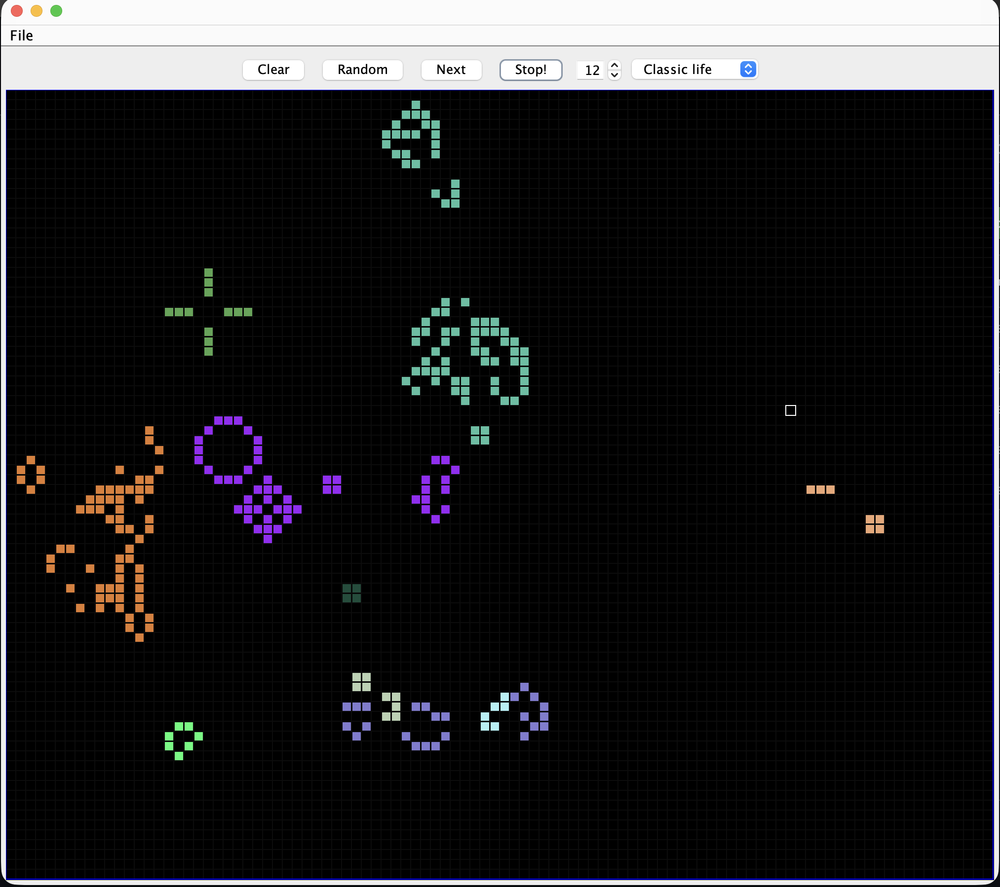

# Game of Life

[](https://github.com/vyshkov/GameOfLife/actions/workflows/build.yml)

A colourful [Conway's Game of Life](https://en.wikipedia.org/wiki/Conway%27s_Game_of_Life) simulator written in Java with Swing.



## Features

- 100x80 wrapping (toroidal) field.
- Four rule sets: Classic life, Gnarl, Maze and Coagulations.
- Cells have colours: a newborn cell takes the most common colour among its live neighbours, falling back to recently dead neighbours and then to a random colour.
- Resizable window; cells scale with it and stay square.
- Draw, erase, randomize, single-step or run continuously at an adjustable speed.

## Requirements

- JDK 25 (the current LTS).
- Maven is optional; `run.sh` falls back to plain `javac`.

## Run

```sh
./run.sh
```

With Maven:

```sh
mvn package
java -jar target/GameOfLife-1.0-SNAPSHOT-jar-with-dependencies.jar
```

## Controls

| Control | Action |
| --- | --- |
| Left click / drag | Bring cells to life |
| Right drag | Erase a 9x9 area |
| Clear | Remove all cells |
| Random | Fill the field randomly |
| Next | Advance one generation |
| Start! / Stop! | Run or pause the simulation |
| Spinner | Delay between generations (value x 25 ms) |
| Rule selector | Switch the rule set |

## Rules

Rules are listed in birth/survival notation (`B`/`S` followed by neighbour counts).

| Name | Rule |
| --- | --- |
| Classic life | B3/S23 |
| Gnarl | B1/S1 |
| Maze | B3/S12345 |
| Coagulations | B378/S235678 |

## Project layout

- `core`: field, cells, generation step and colour logic.
- `rules`: `LifeRule` implementations.
- `gui`: Swing windows and the field panel.
